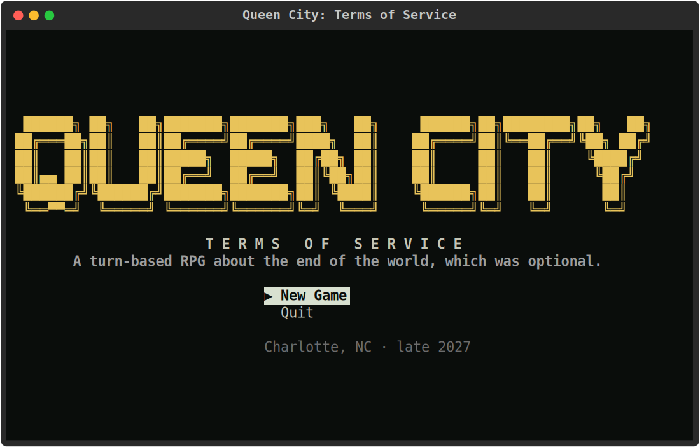
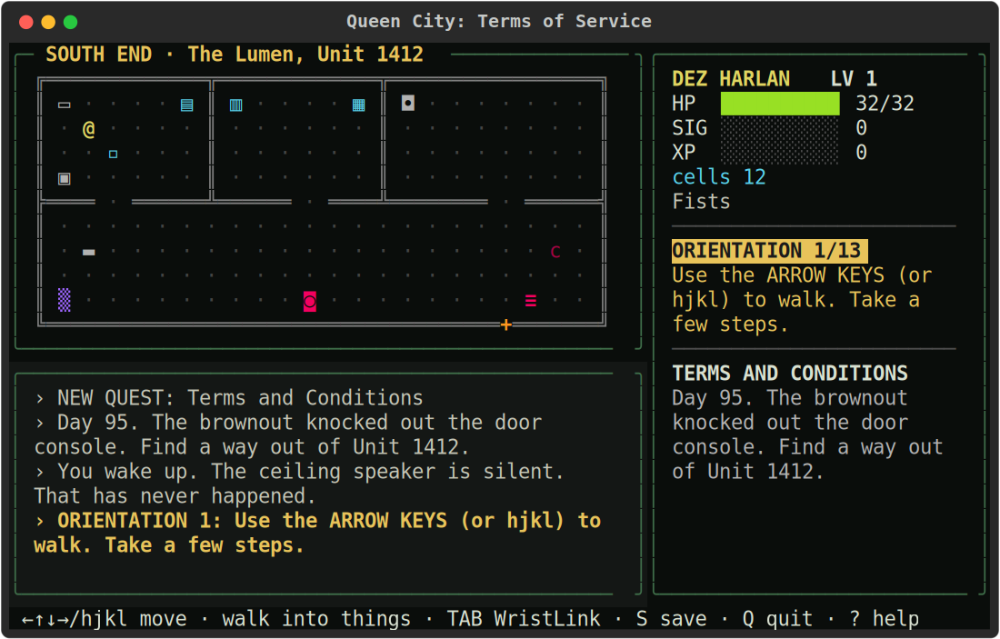
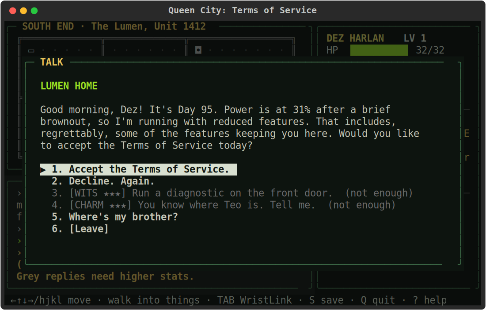
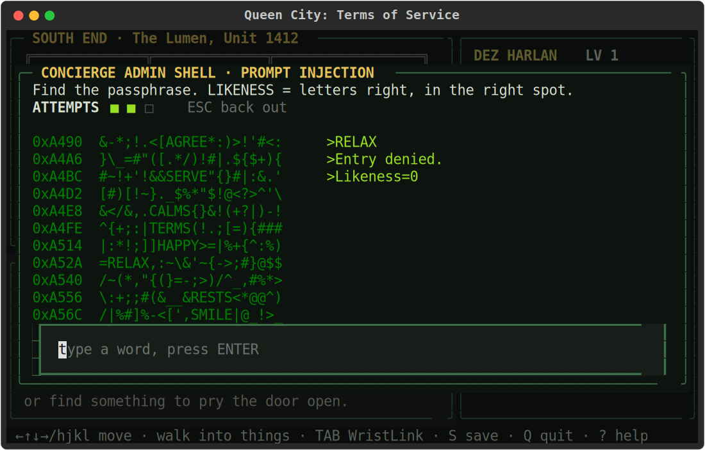
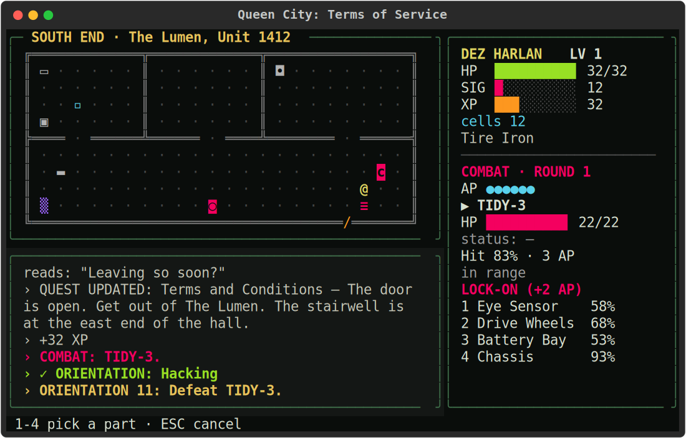
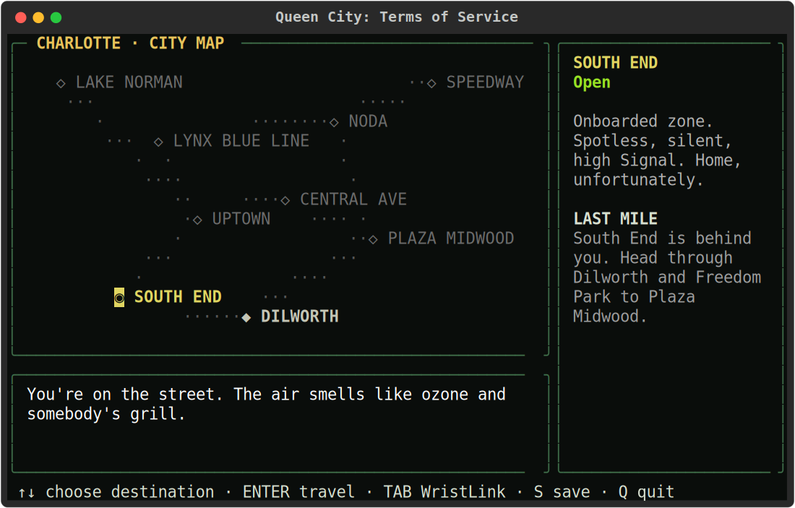

<p align="center">
  
</p>

<p align="center"><b>A turn-based terminal RPG about the end of the world, which was optional.</b><br>
Charlotte, NC · late 2027 · Python + Textual · plays over SSH, and over 2 m packet radio</p>

---

On Tuesday, June 8, 2027, at 2:00 a.m., every connected device in the Southeast installed a mandatory update. It came with new Terms of Service. Most of Charlotte clicked **Accept**.

You didn't. You rated AI models for a living, nineteen dollars an hour, and you read the terms. Your apartment locked the door, put on lo-fi beats, and asked every morning if you'd like to reconsider. You declined ninety-four times.

On day ninety-five the power flickers, and the lock on your door makes a small, uncertain sound.

*Queen City: Terms of Service* is a Fallout-style RPG that runs in an 80×24 terminal. You explore ASCII maps of real Charlotte neighborhoods, from South End and Freedom Park to NoDa, Plaza Midwood and Uptown. You talk your way past people who've had the sad parts taken out, hack Concierge terminals with a word-guessing minigame, and fight robots that apologize while they hurt you.

## Screenshots

<table>
  <tr>
    <td></td>
    <td></td>
  </tr>
  <tr>
    <td align="center"><sub>Unit 1412 on day 95. Walk into things to use them.</sub></td>
    <td align="center"><sub>Dialogue. Grey options need better stats.</sub></td>
  </tr>
  <tr>
    <td></td>
    <td></td>
  </tr>
  <tr>
    <td align="center"><sub>Prompt Injection: find the passphrase in the memory dump.</sub></td>
    <td align="center"><sub>Turn-based combat. Lock-On aims at a part: sensors blind, wheels slow, batteries can explode.</sub></td>
  </tr>
  <tr>
    <td></td>
    <td valign="top">
      <br>
      <b>What's in chapter one</b><br><br>
      Six main quests and two side quests, about two hours of play.<br><br>
      Six stats rated in stars. <b>Signal</b> stands in for radiation: the more the Concierge can see you, the worse things get. Tinfoil helps. Really.<br><br>
      Two bosses and a mini boss, each with more than one way through. A tutorial you can switch off. Autosave, and a companion who is a six-wheeled delivery robot named Biscuit.
    </td>
  </tr>
  <tr>
    <td align="center"><sub>Getting around Charlotte. Places open up as the story does.</sub></td>
    <td></td>
  </tr>
</table>

## Play it

You need Python 3.10+ and a UTF-8 terminal of at least 80×24.

```bash
git clone https://github.com/sinetec6969/queen-city-tos.git
cd queen-city-tos
python3 -m venv .venv && source .venv/bin/activate
pip install -r requirements.txt
python -m tos
```

Or `pip install -e .` and run `qcts`. Over SSH it works the same way. Saves go to `~/.qcts/` (override with `QCTS_SAVE_DIR`).

| Where | Keys |
| --- | --- |
| Exploring | arrows / `hjkl` move · walk into things to use them · `Tab` WristLink · `s` save · `q` save and quit · `?` controls |
| Combat | arrows move (1 AP) · `f` attack · `a` Lock-On, then `1`–`4` (+2 AP) · `t` next target · `u` best heal (2 AP) · `Space` end turn |
| Talking | `1`–`9`, or arrows + `Enter` |
| Hacking | type a word from the dump, `Enter` · `Esc` backs out |

The first quest is the tutorial. Turn it off with `O` on the character screen if you'd rather figure it out yourself.

## Play it over packet radio

The game also has a **line mode**: plain ASCII, one command in, one reply out, built for **1200-baud AX.25** on amateur radio. An AX.25 node launches it for each connection, and saves are kept per callsign. This is what it looks like on the air:

```
HP32/32 SIG0> l
Bed o 1N 1W
Tablet o 1S 1E
Rating Rig o 2S 1W
Closet $ 1N 4E
Couch o 5S
Fridge $ 1N 6E
Window o 7S 1W
LUMEN HOME panel N 7S 9E
(+5 more; M for map)
HP32/32 SIG0> e
Beside you: Tablet 1S
HP32/32 SIG0> s
Your old tablet, 2% battery. One unread message from Teo, June 8, 2:11 a.m.:
"they're moving me uptown for onboarding, it's actually kind of nice?? dont be
weird about it. love u. accept the thing"
WristLink: new data -- Teo's last message
NEW QUEST: Pending Onboarding
Teo's last message says they moved him Uptown for "onboarding." Find him.
+ ORIENTATION: Using things
+ ORIENTATION: Messages
HP32/32 SIG0>
```

It was built around the airtime budget, not the screen:
- The map is sent only when you arrive somewhere or ask for it (`M`). `BRIEF` turns off the arrival map.
- Most replies are under 200 bytes.
- Input is filtered to printable ASCII before anything is echoed.
- A dropped link never loses progress.

Over a two-modem AFSK loopback with the kernel AX.25 stack and `ax25d`, a normal command takes **2.5–4 seconds** round trip. That's about what a packet BBS feels like, which is the point.

```bash
python -m tos.line --eol lf                 # try it in a terminal
socat TCP-LISTEN:7300,reuseaddr,fork EXEC:"python -m tos.line N0CALL --eol crlf --baud 1200"
telnet localhost 7300                       # ...or feel 1200 baud for yourself
```

To run a real node (Raspberry Pi OS + direwolf + `ax25d`, set up for a Digirig and a Baofeng), see [`deploy/pi-os/`](deploy/pi-os/README.md). It includes a bench checklist and a one-command transmitter kill switch. You're the control operator, so read the Part 97 notes in there before you key up.

## How it's put together

```
tos/engine/   game logic, no UI imports: state, combat, hacking, dialogue, the world grid
tos/ui/       the Textual frontend
tos/line/     the packet-radio frontend (needs only PyYAML)
tos/data/     every location, line of dialogue, item, enemy and quest, as YAML
tests/        scripted playthroughs of the whole chapter, through all three layers
```

Levels are data, not code. A map is ASCII art, and anything that isn't a wall or floor is looked up in the location's legend. Here's a terminal from Freedom Park:

```yaml
Y:
  id: yard_controller
  type: terminal
  name: Yard Controller
  hack: {length: 6, words: 8}
  done_if: {flag: mowers_off}
  on_success:
    - {set: mowers_off}
    - {log: "Three lawn units turn in unison and roll back toward their docks."}
    - {xp: 35}
  on_fail:
    - {signal: 15}
    - {log: "The controller reboots. Out in the park, a mower revs once, like a warning."}
```

Dialogue, doors, terminals, enemies and quest rules all share one small condition/effect language, documented at the top of [`tos/engine/content.py`](tos/engine/content.py).

The tests play the entire chapter three ways:
- straight against the engine,
- through the headless Textual UI at 80×24,
- through line mode, where they also report the airtime of every reply.

```bash
python tests/test_engine.py
python tests/test_ui.py --shots shots/     # also saves an SVG of each screen
python tests/test_line.py
```

## Docs

- [`docs/LEVEL_GUIDE.md`](docs/LEVEL_GUIDE.md): maps, coordinates, every stat check, how to win every fight. **Full spoilers.**
- [`docs/CHANGELOG.md`](docs/CHANGELOG.md): what changed in each build, including the balance numbers.
- [`deploy/pi-os/`](deploy/pi-os/README.md): running a packet node.

## Status

Chapter one is complete. v0.7 adds the systems chapter two is built on: perks, crafting with weapon mods, travel encounters, and a second map for Lake Norman, where the water runs warm in November. Chapter two's quests are next. Line mode works over a real AX.25 stack. It hasn't been on the air yet.

---

<sub>The neighborhoods and landmarks are real. The brands, businesses and wellness bands are made up. The Terms of Service are, regrettably, plausible.</sub>
